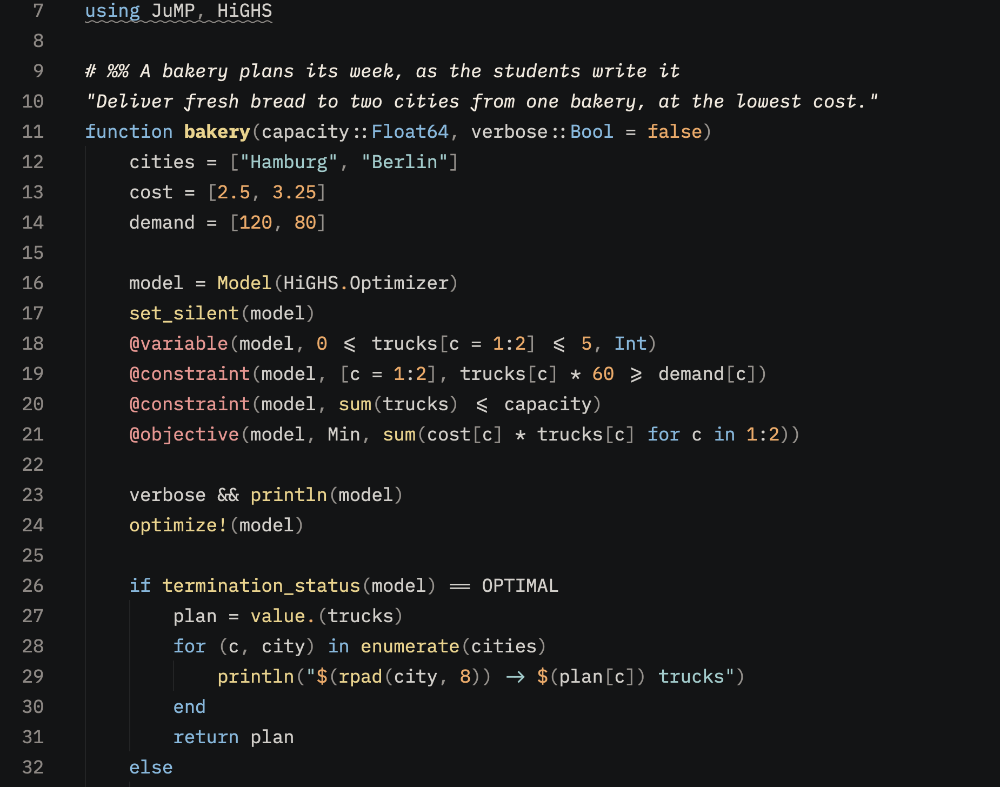

# Paper & Ink

A dark and a light [Zed](https://zed.dev) theme for files that are mostly text:
the comments read like the page, the code sits underneath in soft colours.
**Paper & Ink Dark** puts paper-white comments on deep ink; **Paper & Ink Light**
puts ink comments on paper.



Most themes grey out comments. In tutorials and notebooks in percent format
(`# %%` cells), the comments are the instructions, so Paper & Ink gives them the
strongest contrast on screen, sets them in italic and gives the code fewer,
calmer colours.

I built it primarily with the students in my courses in mind, especially those
learning Julia and JuMP: lecture notes, exercise sheets and tutorial cells are
mostly prose with short bursts of code in between, and that is what it is
tuned for. The terminal's ANSI colours match the editor, so the Julia REPL
reads like the notebook around it.

## Install

Open the command palette (`Cmd+Shift+P` on macOS, `Ctrl+Shift+P` elsewhere),
choose **zed: extensions**, search for "Paper & Ink" and install it. Then pick
**Paper & Ink Dark** or **Paper & Ink Light** with **theme selector: toggle**.
To follow your system's light and dark mode, put this in your settings
(**zed: open settings file**):

```json
"theme": { "mode": "system", "light": "Paper & Ink Light", "dark": "Paper & Ink Dark" }
```

## Colours

The light theme follows the course websites: slate ink from their `#363D45`
text, a peach active line like their code-line highlight, and errors in their
brick red `#9E2B2B`.

Every colour is defined once in `build.py` as OKLCH. On the editor background,
contrast follows APCA: comments Lc 94 (dark) and 101 (light), plain code Lc 77
and 88, and every syntax hue at least Lc 55. Every text colour — line numbers,
panel and status text, the terminal foregrounds and the ANSI colours in their
text roles included — meets WCAG 2 AA (4.5:1) on every surface it appears on,
and reading text keeps AA under the editor's tinted washes. What sits below on
purpose: errors and punctuation (Lc 45 and 35 — underlines and de-emphasized
marks, not reading text; they fade under washes), the dim ANSI variants, the
dark terminal's grey, and text under the active search match, a transient
highlight like selection — all at 3:1. On paper, brightness reads as
saturation: the light theme's bright ANSI colours are the vivid versions of
the base hues, not lighter ones.

| Role | Dark | Light |
|---|---|---|
| Comments (italic), markdown text | `#F2EADE` | `#21272E` |
| Plain code | `#D2CFCA` | `#484E54` |
| Function calls (bold where defined) | `#EED284` | `#785503` |
| Strings | `#97CDCC` | `#157171` |
| Numbers, constants | `#F5A75E` | `#A54C02` |
| Keywords, types | `#7ABAE0` | `#1868A0` |
| Macros, decorators | `#F3928F` | `#B03557` |
| Background | `#131415` | `#FFFDFC` |

Every colour at a glance: open [`showcase.jl`](showcase.jl) in Zed — a small,
runnable JuMP model that uses one of each.

## Rebuild

`uv run build.py` writes `themes/paper-and-ink.json` and fails if a colour drops
below its contrast floor. It also writes `quarto/`: the highlight themes and colour variables the course
websites use, synced to them by Lecture-Foundations.
`uv run test_build.py` checks the colour maths.

## License

MIT
